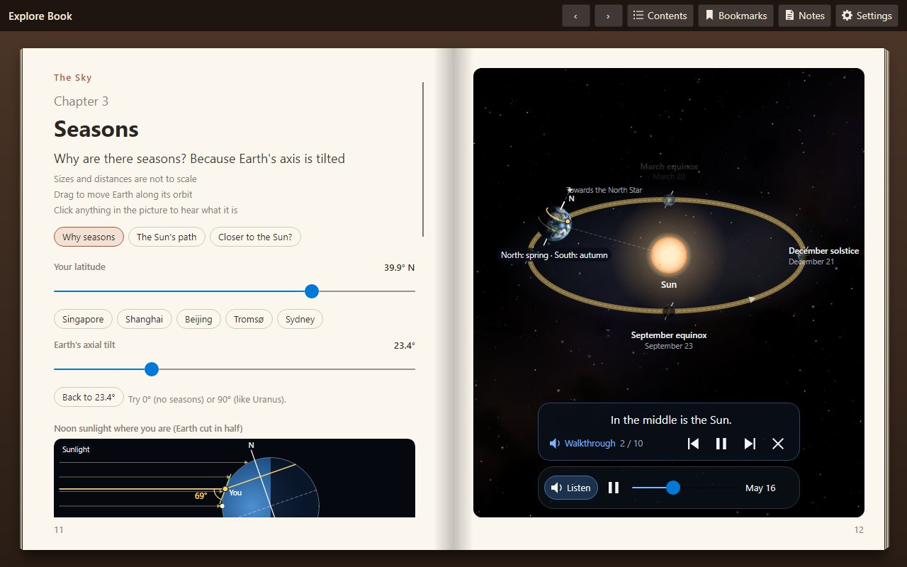
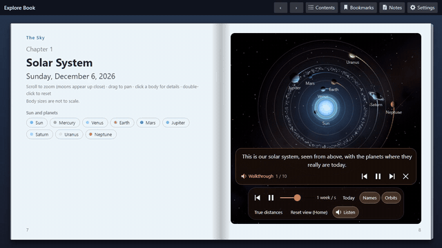
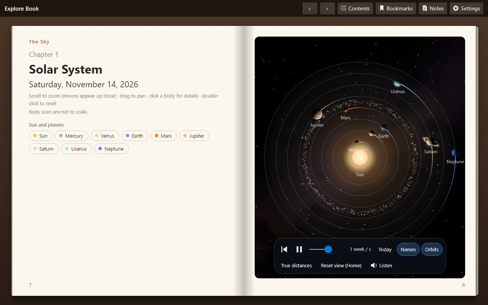
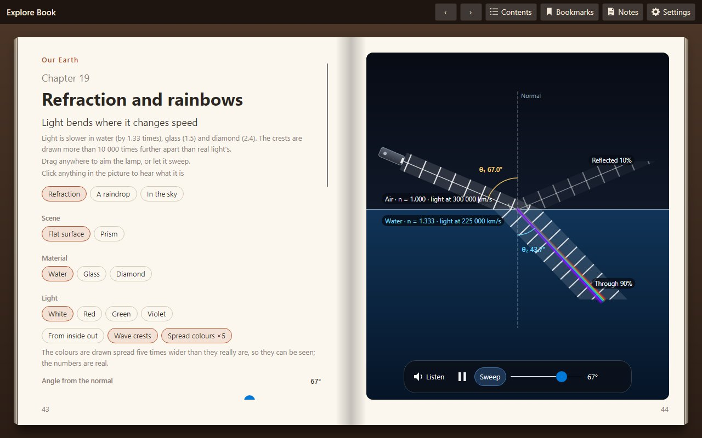
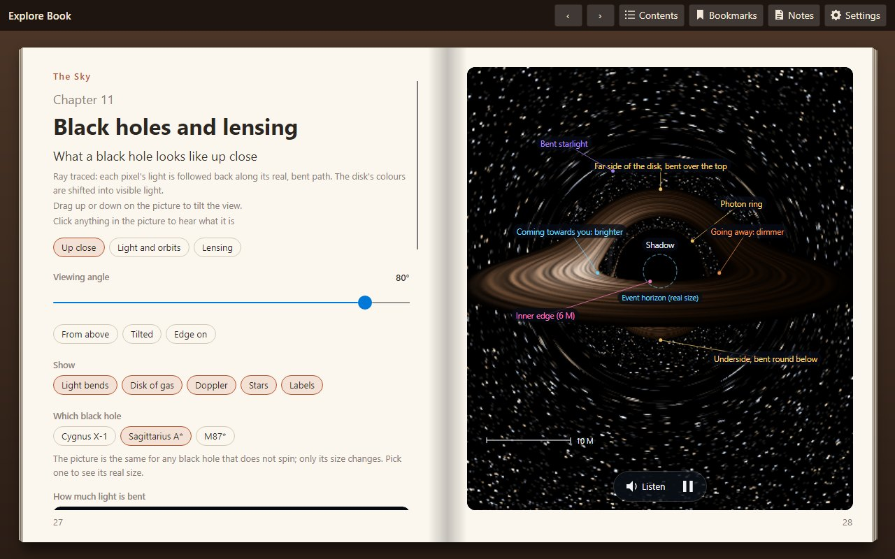
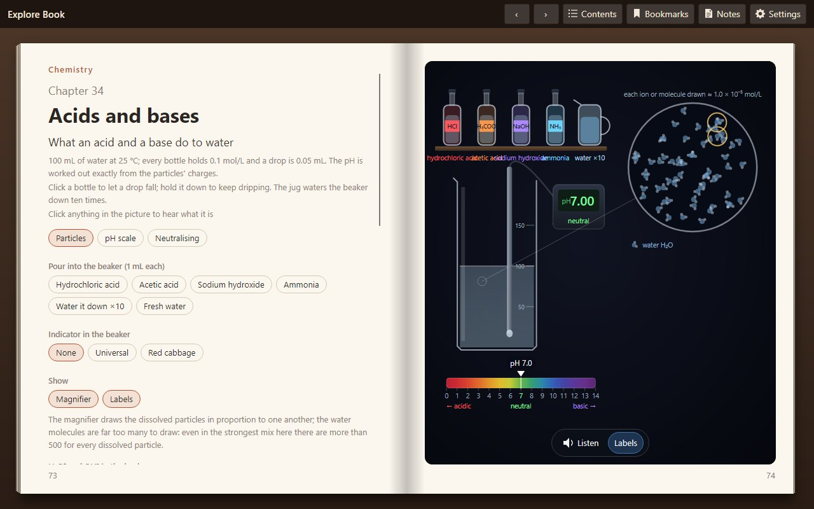
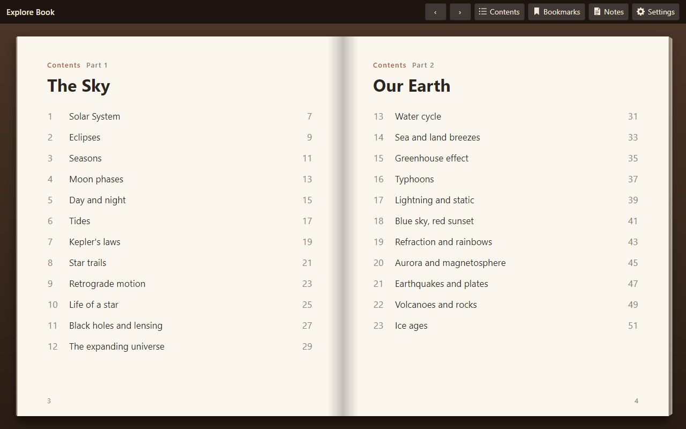
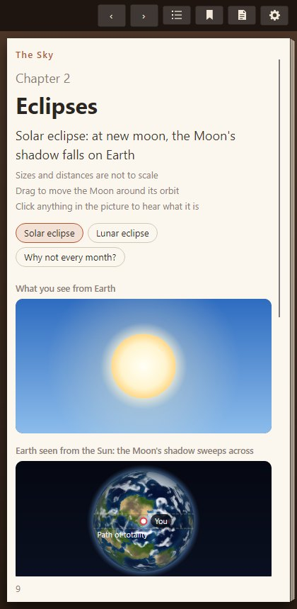

<div align="center">


# The Explore Book

**An interactive science book for curious kids — 34 chapters you can read, touch and listen to, in English and Chinese.**

**English** · [简体中文](README.zh-CN.md)

[](https://book-explore.lemontree.asia)
[](https://github.com/tracyma-05/Lemon.Explore.Book/releases/latest)


[](LICENSE)



</div>

A real book on the screen: a cover, a table of contents, and one spread per chapter — words on the left, a living
picture on the right. Drag the Earth round the Sun, bend light through a raindrop, fire a cannon, drip a base into an
acid. Every chapter has a spoken walkthrough that sets the scene, points at things, asks a question and waits for you
to have a go.

## ▶ See it in action

<div align="center">

[](docs/videos/solar-system-en.mp4)

*The Solar System chapter's walkthrough, recorded from the book itself. Click for the two-minute video with sound.*

</div>

## ✨ What's inside

<table>
<tr>
<td width="50%"><br/><b>The sky</b> — planets on their real orbits, eclipses, seasons, moon phases, tides, black holes and the expanding universe.</td>
<td width="50%"><br/><b>Our Earth</b> — the water cycle, typhoons, lightning, rainbows, auroras, earthquakes and volcanoes.</td>
</tr>
<tr>
<td><br/><b>Things to play with</b> — every picture responds: drag, scrub through time, change the tilt, click anything to hear what it is.</td>
<td><br/><b>Physics and chemistry</b> — pendulums, waves, lenses, engines, relativity, and a titration you run yourself.</td>
</tr>
</table>

- 📖 **A book that feels like one.** Pages turn with a paper curl you can drag; the contents page tracks what you
  have read; bookmarks, notes (exported as Markdown) and a reading position that is remembered.
- 🗣️ **Read aloud, in two languages.** Every lesson is narrated in English and Chinese with subtitles, at the speed
  you choose. Switch language at any time — the whole book follows.
- 🧭 **Guided, not just animated.** Walkthroughs highlight what they talk about, ask questions with answers to pick,
  and hand over the controls: "your turn".
- 🌍 **About where you are.** Set your city once and the sky chapters show your latitude, your sunrise, your tides.
- 💻 **Everywhere.** Windows and macOS apps that update themselves, and the same book in the browser as an
  installable PWA — on a phone it reads one page at a time.

<details>
<summary><b>All 34 chapters</b></summary>

| The Sky | Our Earth | Physics | Chemistry |
|---|---|---|---|
| Solar System | Water cycle | Pendulum and spring | Acids and bases |
| Eclipses | Sea and land breezes | Interference and Doppler | |
| Seasons | Greenhouse effect | Sound and instruments | |
| Moon phases | Typhoons | Projectile motion | |
| Day and night | Lightning and static | Flight and lift | |
| Tides | Blue sky, red sunset | Lenses, eye and camera | |
| Kepler's laws | Refraction and rainbows | Atoms and spectra | |
| Star trails | Aurora and magnetosphere | Engine and fridge | |
| Retrograde motion | Earthquakes and plates | Generator and grid | |
| Life of a star | Volcanoes and rocks | Special relativity | |
| Black holes and lensing | Ice ages | | |
| The expanding universe | | | |

</details>

<table>
<tr>
<td width="62%"></td>
<td width="38%"></td>
</tr>
</table>

## 🚀 Get it

| | |
|---|---|
| 🌐 **In the browser** | Open **[book-explore.lemontree.asia](https://book-explore.lemontree.asia)**. Use the browser's *Install* to keep it as an app; it then works offline. |
| 🪟 **Windows** | Download `explore-book-<version>-win-x64.zip` from the [latest release](https://github.com/tracyma-05/Lemon.Explore.Book/releases/latest), unzip, run `ExploreBook.exe`. |
| 🍎 **macOS** | Download the `osx-arm64` (Apple silicon) or `osx-x64` (Intel) zip, unzip, then right-click **Explore Book** → **Open** the first time (the app is not notarised). |

The desktop apps check for updates when they open and install them in place (**Update and restart**), from this
repository's GitHub Releases. No account, no sign-in, no tracking: settings, notes and progress stay on your device.

## 🛠️ Build from source

Requires the [.NET 10 SDK](https://dotnet.microsoft.com/download).

```bash
dotnet run --project src/Lemon.Explore.Book.Desktop
```

```bash
dotnet test
```

The web edition also needs the WebAssembly build tools (once per machine):

```bash
dotnet workload install wasm-tools
```

```bash
dotnet run --project src/Lemon.Explore.Book.Browser -c Release
```

The Debug web build runs interpreted and is only good for checking layout; the Release build is AOT-compiled to
WebAssembly and runs smoothly (the first build takes several minutes).

<details>
<summary><b>Native AOT, packaging and releases</b></summary>

The desktop book builds as a native AOT app (no .NET runtime needed, fast start). The shared library is marked
`IsAotCompatible`, so a change that would break AOT or trimming shows up as a build warning.

```bash
dotnet publish src/Lemon.Explore.Book.Desktop -c Release -r win-x64 -p:PublishAot=true
```

Use `osx-arm64` / `osx-x64` on a Mac. On Windows this needs the Visual Studio C++ build tools (the linker).

- `scripts/package-desktop.sh <rid> [update-address]` builds one desktop package the way the release does.
- `scripts/publish-local.ps1` publishes the Windows AOT build into a local folder (`-Zip` also writes the package).
- A Release build updates from this repository's GitHub Releases by default. The address can be changed at build
  time (`-p:UpdateFeed=…`, or `off`), with `update-feed.txt` next to the program, or in Settings → Updates; it can
  point at any server with a small JSON manifest. See [docs/UPDATES.md](docs/UPDATES.md).
- Publishing a release: set `<Version>` in `Directory.Build.props`, then push a `v*` tag;
  `.github/workflows/release.yml` builds and publishes everything.

</details>

<details>
<summary><b>Narration</b></summary>

Walkthroughs and object cards are read aloud from pre-rendered mp3 clips, one per `Narr_*` string and language. The
manifest (`assets/narration/narration.json`) is in git; the audio (`assets/narration/audio`, about 180 MB) is not.
Render it, or only what changed after editing a `Narr_*` string, with:

```bash
pip install edge-tts
python -I scripts/narration/generate-narration.py
```

`--seed-from <folder>` first copies clips from another narration folder whose text matches, and `--check` lists
missing or stale clips without rendering. Without the clips, narration runs as timed subtitles. The voices and their
licence status are in [THIRD-PARTY-NOTICES.md](THIRD-PARTY-NOTICES.md).

Release builds get the clips from the `narration-v1` pre-release (one zip per language). After rendering changed
clips, upload them again before tagging a release:

```bash
python -I scripts/narration/narration-pack.py pack --upload
```

</details>

<details>
<summary><b>Videos and screenshots</b></summary>

The book can film itself. `scripts/video/make-chapter-video.py` plays a chapter's walkthroughs in a headless window
on a stepped clock — every frame moves the book on exactly 1/30 s, however long it takes to draw — and lays the
narration on top:

```bash
python -I scripts/video/make-chapter-video.py --chapter Seasons --culture en
```

`--views` records only some of a chapter's views, `--layout phone` films the phone layout (9:16), `--scale 1.5` gives
1080p. `scripts/readme/make-images.py` renders this README's screenshots the same way, and
`scripts/appicon/make-icons.py` draws the icon.

</details>

<details>
<summary><b>Hosting the web edition</b></summary>

The web edition is static files, so any static host works. `deploy/cloudflare` hosts it on Cloudflare as one Worker
on one origin: static assets serve the app, and an R2 bucket serves what static assets cannot hold (the AOT-compiled
runtime, over the 25 MiB per-file limit). The narration clips are deployed as static assets under `narration/`.

```bash
deploy/cloudflare/deploy.sh
```

It needs Node.js, an existing R2 bucket and `CLOUDFLARE_ACCOUNT_ID` / `CLOUDFLARE_API_TOKEN` in the environment.
Neither is stored in the repository.

</details>

<details>
<summary><b>Reading tips</b></summary>

- Turn a page: drag a page's outer edge, click it, or press ← / →. F11 reads full screen.
- **Contents** goes back to the table of contents, which shows the chapters you have opened and the walkthroughs you
  have heard to the end.
- **Bookmarks** (Ctrl+D) marks the page you are reading; the book also reopens where you left it.
- **Notes**: write a note on any page, quote its text (right-click → **Add to notes**), and **Export** them all as
  Markdown.
- **Settings**: language, light or dark paper and an accent colour, your location, narration (voice, volume, speed,
  subtitles), page-turn animation, updates, and clearing your reading progress.

</details>

## 🗂️ Project layout

| Path | What |
|---|---|
| `src/Lemon.Explore.Book` | Everything shared: the book control (`Controls/BookView`), chapters (`Chapters/<Topic>`), localization, settings |
| `src/Lemon.Explore.Book.Desktop` | Windows / macOS head |
| `src/Lemon.Explore.Book.Browser` | WebAssembly head with PWA manifest and service worker (`wwwroot`) |
| `tests/Lemon.Explore.Book.Tests` | Unit and headless UI tests (and the video and screenshot exporters) |
| `scripts/` | Repository checks, packaging, narration, videos, screenshots and the icon |
| `assets/narration` | Narration manifest (committed) and the rendered clips (`audio/`, not committed) |
| `deploy/cloudflare` | Cloudflare Worker, R2 routing and deploy script for the web edition |
| `docs/` | [Roadmap](docs/ROADMAP.md), [updates](docs/UPDATES.md), README images and videos |

## 🤝 Contributing

Issues and pull requests are welcome.

- Every user-visible string goes in both `Resources/AppStrings.resx` and `AppStrings.zh-CN.resx`;
  `LocalizationCoverageTests` enforces it. Porting a chapter follows "Porting a chapter" in
  [docs/ROADMAP.md](docs/ROADMAP.md); Seasons is the reference.
- This repository is public. Never commit credentials, private host names or personal data. Enable the pre-commit
  check once with `git config core.hooksPath .githooks`; CI runs it again, with gitleaks.
- Run `dotnet test` before sending a change.

## 📄 Licence

MIT, see [LICENSE](LICENSE). Bundled fonts and data keep their own licences, and the narration voices have their own
terms — see [THIRD-PARTY-NOTICES.md](THIRD-PARTY-NOTICES.md).
