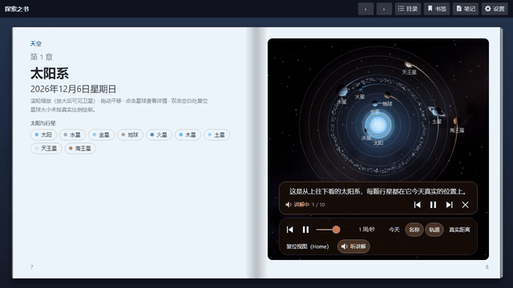
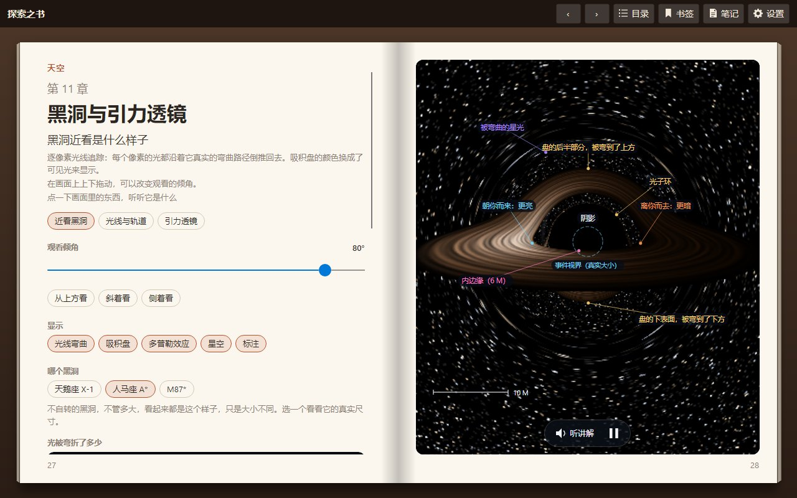
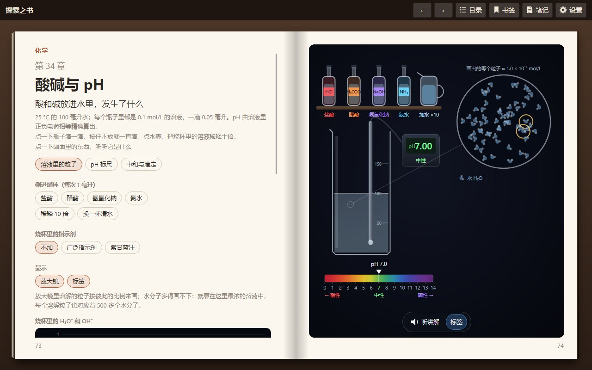

<div align="center">


# 探索之书

**一本给好奇孩子的互动科学书：34 个章节，能读、能玩、能听，中英双语。**

[English](README.md) · **简体中文**

[](https://book-explore.lemontree.asia)
[](https://github.com/tracyma-05/Lemon.Explore.Book/releases/latest)


[](LICENSE)


</div>

屏幕上的一本真书：有封面、有目录，每章占一个跨页，左页读、右页玩。拖着地球绕太阳转，让光穿过一滴雨水，发射一枚炮弹，
往酸里一滴滴加碱。每一章都有语音讲解：先把场景摆好，指给你看，再提一个问题，然后把控制权交给你——“轮到你了”。

## ▶ 看看它的样子

<div align="center">

[](docs/videos/solar-system-zh-CN.mp4)

*“太阳系”一章的讲解，直接由书本身录制。点击观看两分钟的有声视频。*

</div>

## ✨ 书里有什么

<table>
<tr>
<td width="50%"><br/><b>天空</b>：按真实轨道运行的行星、日食月食、四季、月相、潮汐、黑洞和膨胀的宇宙。</td>
<td width="50%"><br/><b>地球</b>：水循环、台风、雷电、彩虹、极光、地震和火山。</td>
</tr>
<tr>
<td><br/><b>每张图都能玩</b>：拖动、拨动时间、改变地轴倾角，点任何东西都会告诉你它是什么。</td>
<td><br/><b>物理和化学</b>：单摆、波、透镜、发动机、相对论，还有一场你亲手做的酸碱滴定。</td>
</tr>
</table>

- 📖 **像一本真正的书。** 翻页有纸张卷曲效果，可以用手拖；目录会记录读过的章节；有书签、笔记（可导出为 Markdown），
  下次打开回到上次读到的地方。
- 🗣️ **中英双语朗读。** 每一课都有中文和英文配音和字幕，语速可调；随时切换语言，整本书跟着变。
- 🧭 **有引导，不只是动画。** 讲解会高亮正在说的东西，提出选择题，再把控制交给孩子动手试。
- 🌍 **和你所在的地方有关。** 设置一次城市，天空的章节就会显示你的纬度、你的日出、你的潮汐。
- 💻 **到处都能读。** Windows 和 macOS 应用会自动更新；同一本书也能在浏览器里作为 PWA 安装，在手机上一次显示一页。

<details>
<summary><b>全部 34 章</b></summary>

| 天空 | 地球 | 物理 | 化学 |
|---|---|---|---|
| 太阳系 | 水循环 | 单摆与弹簧 | 酸碱与 pH |
| 日食与月食 | 海陆风 | 干涉与多普勒 | |
| 四季 | 温室效应 | 声音与乐器 | |
| 月相 | 台风 | 抛体运动 | |
| 昼夜与时区 | 雷电与静电 | 飞行与升力 | |
| 潮汐 | 蓝天与晚霞 | 透镜、眼睛与相机 | |
| 开普勒定律 | 折射与彩虹 | 原子与光谱 | |
| 星轨 | 极光与磁层 | 发动机与冰箱 | |
| 行星逆行 | 地震与板块 | 发电机与电网 | |
| 恒星的一生 | 火山与岩石循环 | 狭义相对论 | |
| 黑洞与引力透镜 | 冰期与米兰科维奇周期 | | |
| 宇宙膨胀 | | | |

</details>

<table>
<tr>
<td width="62%"></td>
<td width="38%"></td>
</tr>
</table>

## 🚀 获取

| | |
|---|---|
| 🌐 **浏览器** | 打开 **[book-explore.lemontree.asia](https://book-explore.lemontree.asia)**。用浏览器的“安装”把它留成一个应用，之后离线也能读。 |
| 🪟 **Windows** | 从 [最新发布](https://github.com/tracyma-05/Lemon.Explore.Book/releases/latest) 下载 `explore-book-<版本>-win-x64.zip`，解压后运行 `ExploreBook.exe`。 |
| 🍎 **macOS** | 下载 `osx-arm64`（Apple 芯片）或 `osx-x64`（Intel）压缩包，解压；第一次打开时右键 **Explore Book** → **打开**（应用未经公证）。 |

桌面版打开时会检查更新，并从本仓库的 GitHub Releases 原地安装（**更新并重启**）。无需账号、无需登录、不做任何追踪：
设置、笔记和阅读进度都只保存在你的设备上。

## 🛠️ 从源码构建

需要 [.NET 10 SDK](https://dotnet.microsoft.com/download)。

```bash
dotnet run --project src/Lemon.Explore.Book.Desktop
```

```bash
dotnet test
```

网页版还需要 WebAssembly 构建工具（每台机器装一次）：

```bash
dotnet workload install wasm-tools
```

```bash
dotnet run --project src/Lemon.Explore.Book.Browser -c Release
```

网页版的 Debug 构建是解释执行的，只适合检查排版；Release 构建会 AOT 编译成 WebAssembly，运行流畅（第一次构建要几分钟）。

<details>
<summary><b>Native AOT、打包与发布</b></summary>

桌面版以 Native AOT 方式构建（不需要安装 .NET 运行时，启动快）。共享库标记了 `IsAotCompatible`，任何破坏 AOT 或裁剪的改动
都会以构建警告的形式出现。

```bash
dotnet publish src/Lemon.Explore.Book.Desktop -c Release -r win-x64 -p:PublishAot=true
```

在 Mac 上用 `osx-arm64` / `osx-x64`。Windows 上需要 Visual Studio C++ 构建工具（链接器）。

- `scripts/package-desktop.sh <rid> [更新地址]`：按发布流程打一个桌面包。
- `scripts/publish-local.ps1`：把 Windows AOT 版发布到本地文件夹（`-Zip` 同时生成安装包）。
- Release 构建默认从本仓库的 GitHub Releases 更新。更新地址可以在构建时改（`-p:UpdateFeed=…`，或 `off`），
  也可以放一个 `update-feed.txt` 在程序旁边，或在“设置 → 更新”里改；它可以指向任何提供小型 JSON 清单的服务器。
  详见 [docs/UPDATES.md](docs/UPDATES.md)。
- 发布新版本：修改 `Directory.Build.props` 里的 `<Version>`，推送一个 `v*` 标签，
  `.github/workflows/release.yml` 会构建并发布全部产物。

</details>

<details>
<summary><b>朗读</b></summary>

讲解和物体说明由预先生成的 mp3 片段朗读，每个 `Narr_*` 字符串、每种语言一个。清单（`assets/narration/narration.json`）
在 git 里，音频（`assets/narration/audio`，约 180 MB）不在。生成全部音频，或只生成改过的 `Narr_*` 字符串：

```bash
pip install edge-tts
python -I scripts/narration/generate-narration.py
```

`--seed-from <文件夹>` 先从另一个文本相同的朗读文件夹复制片段，`--check` 只列出缺失或过期的片段而不生成。没有音频时，
讲解以定时字幕的方式进行。所用声音及其许可情况见 [THIRD-PARTY-NOTICES.md](THIRD-PARTY-NOTICES.md)。

</details>

<details>
<summary><b>视频与截图</b></summary>

这本书可以自己“拍”自己。`scripts/video/make-chapter-video.py` 在无界面窗口里播放一章的讲解，用一个可步进的时钟逐帧
渲染——无论一帧画多久，书里的时间都只前进 1/30 秒——再把朗读配上去：

```bash
python -I scripts/video/make-chapter-video.py --chapter Seasons --culture zh-CN
```

`--views` 只录某几个视图，`--layout phone` 录手机竖屏（9:16），`--scale 1.5` 输出 1080p。
`scripts/readme/make-images.py` 用同样的方式生成本页的截图，`scripts/appicon/make-icons.py` 绘制图标。

</details>

<details>
<summary><b>部署网页版</b></summary>

网页版是纯静态文件，任何静态托管都可以。`deploy/cloudflare` 把它部署为 Cloudflare 上的一个 Worker、同一个源：
静态资源提供应用本身，R2 存放静态资源放不下的部分（AOT 编译后的运行时，超过单文件 25 MiB 限制）。朗读片段作为静态资源
部署在 `narration/` 下。

```bash
deploy/cloudflare/deploy.sh
```

需要 Node.js、一个已建好的 R2 存储桶，以及环境变量 `CLOUDFLARE_ACCOUNT_ID` / `CLOUDFLARE_API_TOKEN`。它们都不存放在仓库里。

</details>

<details>
<summary><b>阅读小技巧</b></summary>

- 翻页：拖动页面外侧边缘、点击它，或按 ← / →。F11 全屏阅读。
- **目录** 回到目录页，上面会显示你打开过的章节，以及听完了几段讲解。
- **书签**（Ctrl+D）标记当前页；书也会在上次离开的地方打开。
- **笔记**：在任何一页写笔记，引用正文（右键 → **添加到笔记**），并把全部笔记 **导出** 为 Markdown。
- **设置**：语言、浅色或深色纸张和强调色、你的位置、朗读（声音、音量、语速、字幕）、翻页动画、更新，以及清除阅读进度。

</details>

## 🗂️ 项目结构

| 路径 | 内容 |
|---|---|
| `src/Lemon.Explore.Book` | 全部共享代码：书本控件（`Controls/BookView`）、各章（`Chapters/<主题>`）、本地化、设置 |
| `src/Lemon.Explore.Book.Desktop` | Windows / macOS 外壳 |
| `src/Lemon.Explore.Book.Browser` | WebAssembly 外壳，含 PWA 清单和 Service Worker（`wwwroot`） |
| `tests/Lemon.Explore.Book.Tests` | 单元测试和无界面 UI 测试（以及视频和截图导出器） |
| `scripts/` | 仓库检查、打包、朗读、视频、截图和图标脚本 |
| `assets/narration` | 朗读清单（提交）和生成的音频（`audio/`，不提交） |
| `deploy/cloudflare` | 网页版的 Cloudflare Worker、R2 路由和部署脚本 |
| `docs/` | [路线图](docs/ROADMAP.md)、[更新说明](docs/UPDATES.md)、README 用的图片和视频 |

## 🤝 参与贡献

欢迎提 Issue 和 Pull Request。

- 每个界面上看得到的字符串都要同时写进 `Resources/AppStrings.resx` 和 `AppStrings.zh-CN.resx`，
  `LocalizationCoverageTests` 会检查。移植新章节请按 [docs/ROADMAP.md](docs/ROADMAP.md) 里的“Porting a chapter”，
  以“四季”为范例。
- 这是公开仓库：不要提交任何凭据、内部主机名或个人信息。执行一次 `git config core.hooksPath .githooks` 启用提交前检查；
  CI 会再查一遍，并运行 gitleaks。
- 提交改动前请先运行 `dotnet test`。

## 📄 许可

MIT，见 [LICENSE](LICENSE)。随附的字体和数据各有其许可，朗读声音也有其自身条款，见
[THIRD-PARTY-NOTICES.md](THIRD-PARTY-NOTICES.md)。
