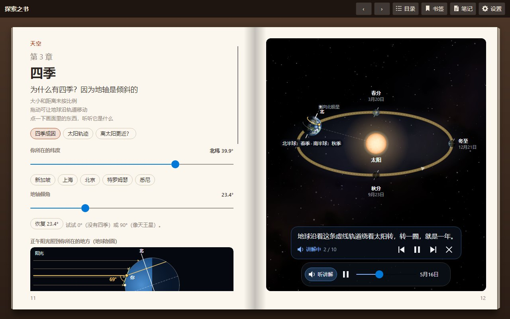
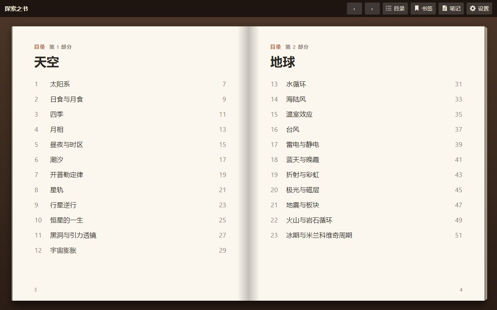
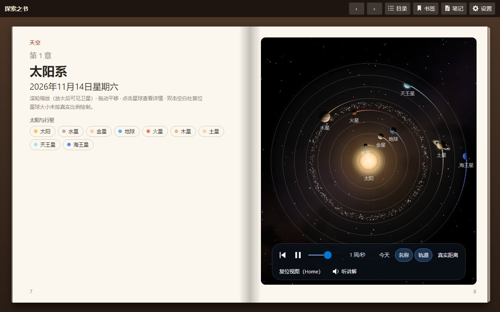
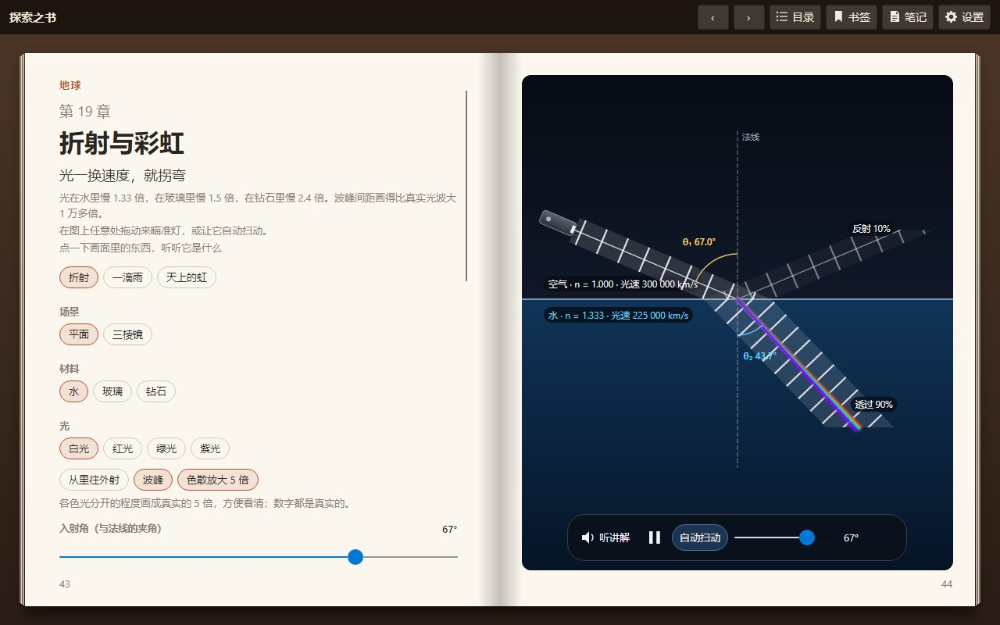
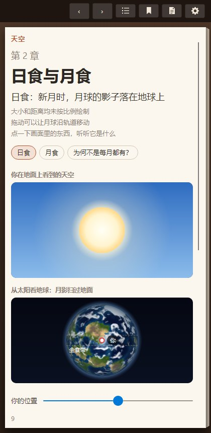

<!--
  微信公众号版。发布时：
  - 图片需要在公众号编辑器里重新上传（本文引用的是 docs/images/zh-CN 下的图）；视频请上传 artifacts/video 里导出的 mp4。
  - 正文中的外部链接在公众号里不能点击：网址保留为纯文本，并把在线阅读地址填到“阅读原文”。
  - 建议标题（任选其一）：
      《地球离太阳最近的时候，为什么是冬天？做了一本会说话的科学书》
      《给孩子做了一本能拖、能点、会说话的科学书，免费开源》
-->

# 给孩子做了一本能拖、能点、会说话的科学书

“妈妈，为什么夏天热、冬天冷？”
“因为夏天地球离太阳近呀。”

这个回答，其实是错的。

**地球离太阳最近的时候，是每年 1 月初**——北半球正是冬天。真正让季节变化的，是地轴那 23.4° 的倾斜。

这样的问题，光靠讲很难讲清楚；但如果孩子能**亲手把地球拖着绕太阳转一圈**，看着阳光直射点从南回归线移到北回归线，
很多事情就一下子明白了。

于是，我做了一本书。

## 📖 这是一本什么样的书

它叫**探索之书**，长得就像一本真正的书：有封面、有目录，翻页时纸张会卷起来，可以用手指拖着翻。

全书 **34 章**，分成四个部分：

- 🌌 **天空**：太阳系、日食月食、四季、月相、潮汐、星轨、黑洞……
- 🌍 **地球**：水循环、台风、雷电、彩虹、极光、地震、火山……
- ⚙️ **物理**：单摆、声音、抛体、飞行、透镜、相对论……
- 🧪 **化学**：酸碱与 pH，亲手做一次滴定实验

每一章占一个跨页：**左边读，右边玩**。

## 🖐️ 每一张图都能动手

右边的图不是插画，而是可以操作的“小实验”：

- 拖动地球，看四季怎么来；
- 让光穿过一滴雨，看彩虹为什么是七种颜色；
- 改变黑洞的观察角度，看光怎么被引力弯曲；
- 往烧杯里一滴一滴加碱，看 pH 曲线怎么突然跳起来。

图里的任何东西都可以点一下，书会告诉你它是什么。

## 🗣️ 有人陪着讲

每一章都有**语音讲解**，中文、英文都有，还配字幕：

1. 讲到哪里，图上就高亮哪里；
2. 讲到关键处，会停下来出一道选择题，让孩子先猜；
3. 然后说一句“**轮到你了**”，把控制权交给孩子自己去试。

不是看动画，而是**边听、边猜、边动手**。

（这里可以插入导出的讲解视频）

## 🌍 和孩子所在的地方有关

在设置里选一下你所在的城市，书里关于天空的章节就会显示：
你那里的纬度、你那里今天几点日出、你那里的潮汐……
科学不再是课本上遥远的知识，而是窗外正在发生的事情。

## 📱 在哪里都能读

- **手机 / 平板 / 电脑浏览器**：直接打开网址就能读，还可以“添加到主屏幕”，离线也能用；
- **Windows、Mac**：有桌面版，会自动更新。

全部**免费**，不需要注册登录，没有广告，也不收集任何数据——笔记、书签、阅读进度都只保存在你自己的设备上。

## 💡 写给家长

- 适合小学高年级到初中的孩子；低年级孩子可以和家长一起玩。
- 建议每次只读一章，先让孩子自己玩右边的图，再听讲解，最后回答书里的问题。
- 中英文可以随时切换：同一章用英文再听一遍，也是不错的英语练习。

这本书的代码完全开源，欢迎懂技术的朋友一起来完善。

---

**在线阅读**：https://book-explore.lemontree.asia
**下载桌面版 / 源码**：在 GitHub 搜索 https://github/tracyma-05/Lemon.Explore.Book

👉 点击“**阅读原文**”，马上翻开这本书。

如果觉得有用，欢迎转给身边有好奇宝宝的朋友 ❤️
